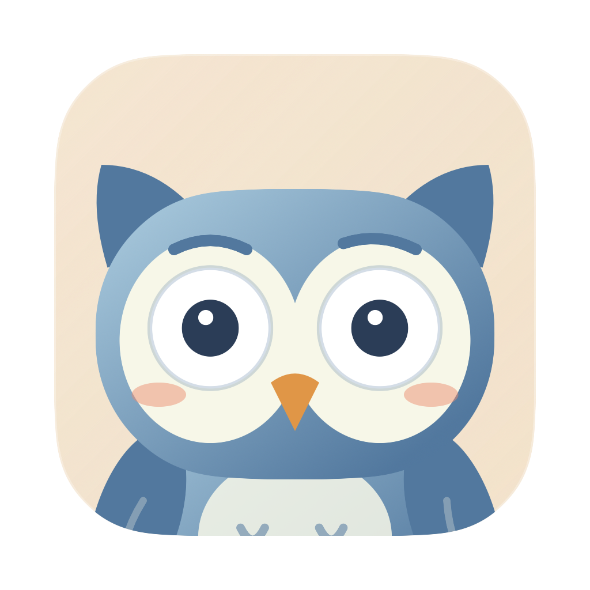
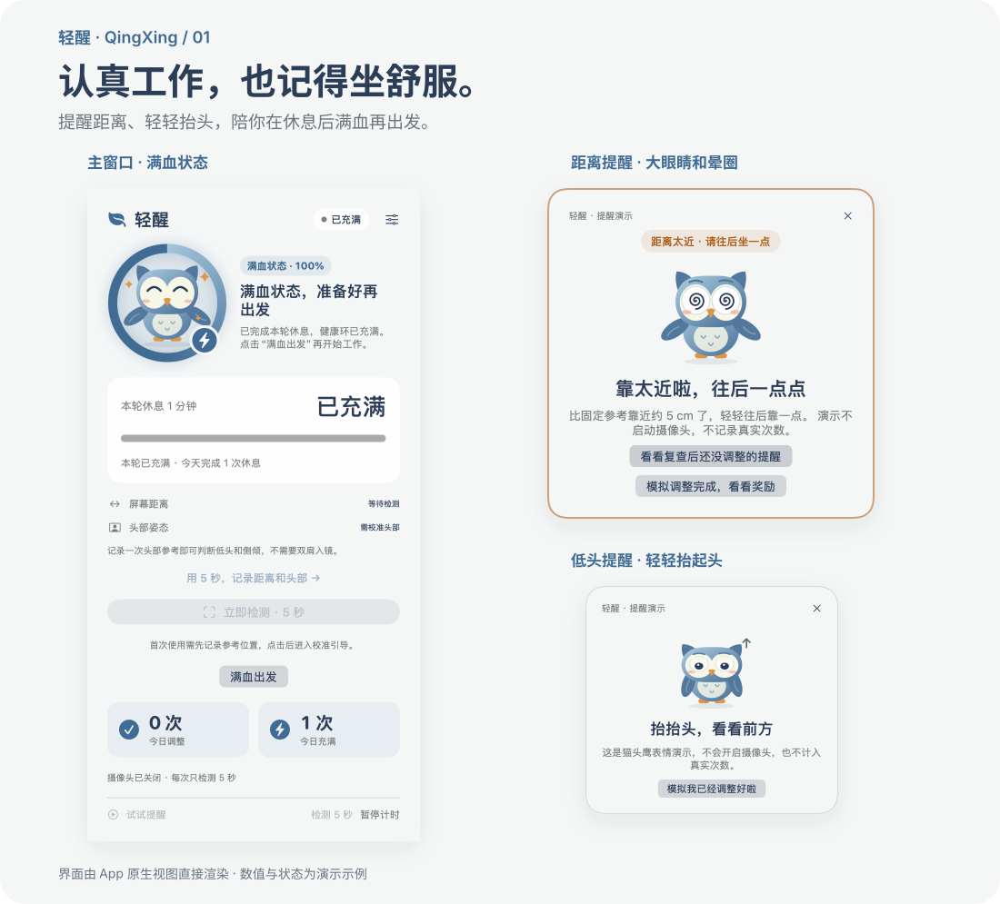
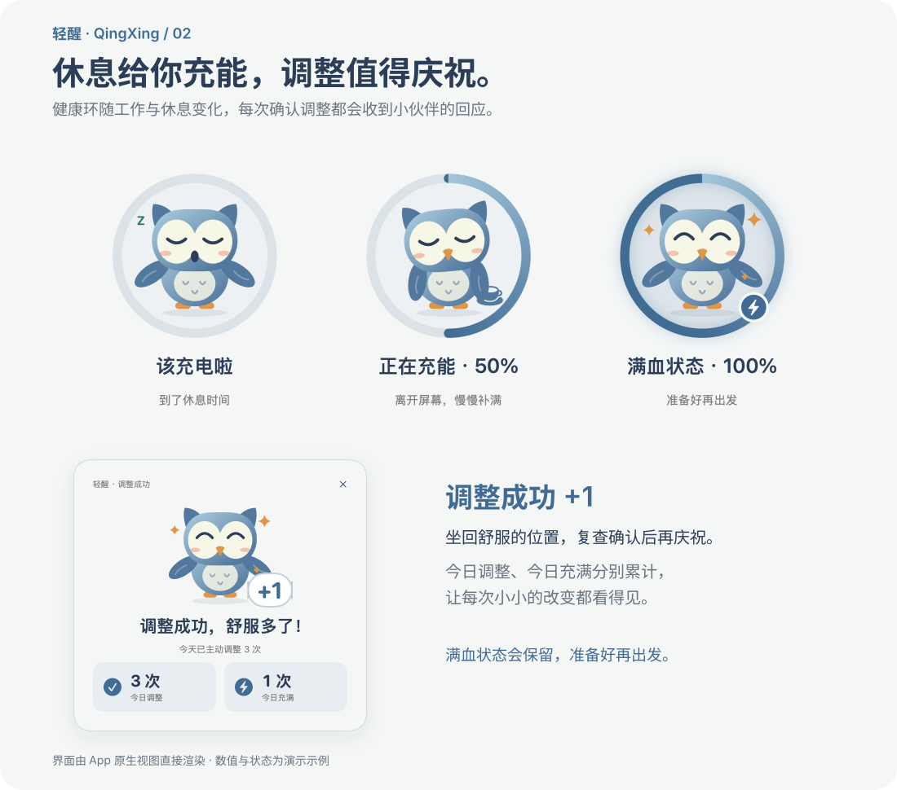
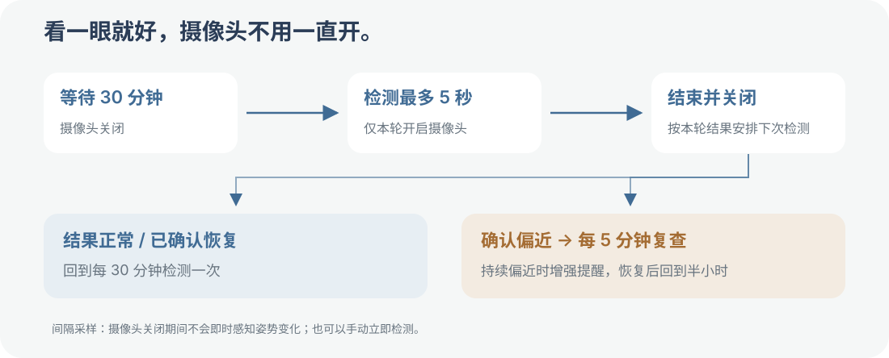
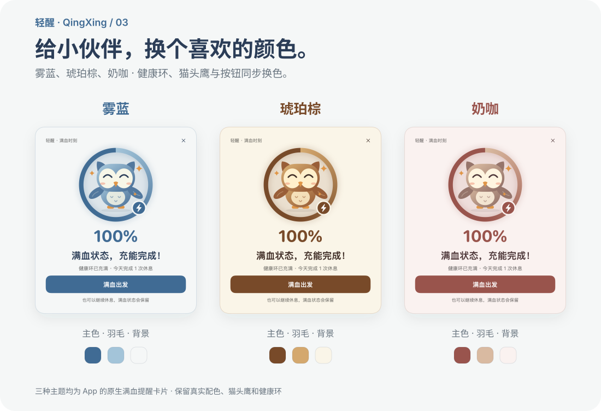
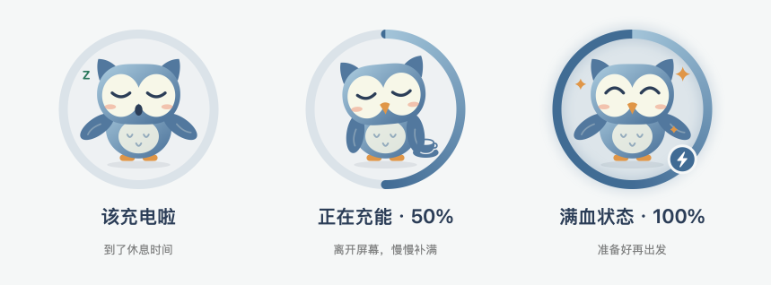
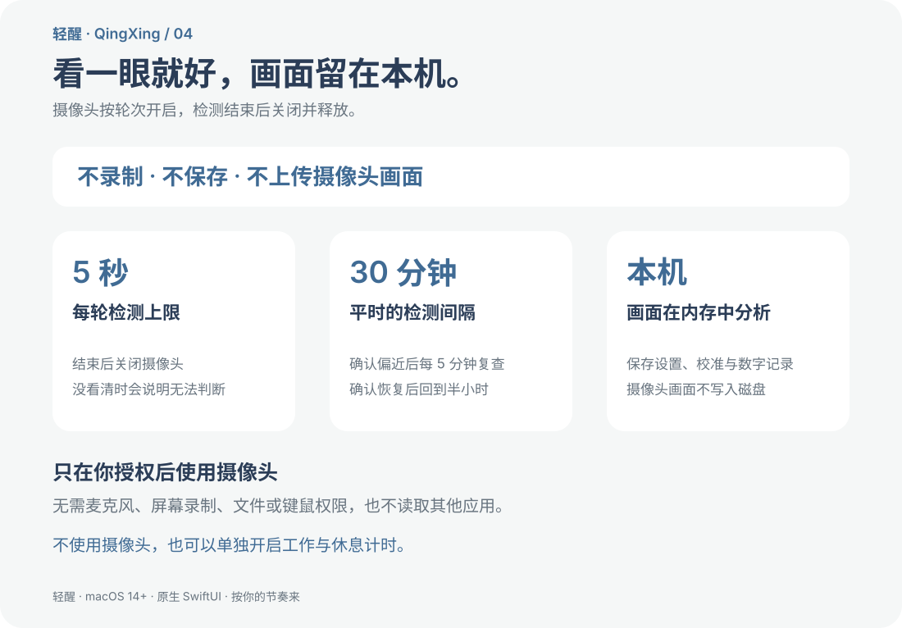

<p align="center">
  
</p>

<h1 align="center">轻醒 · QingXing</h1>
<p align="center"><strong>认真工作，也记得坐舒服。</strong></p>
<p align="center">一个住在 Mac 菜单栏里的小伙伴，提醒距离、抬头和起身休息，用健康环陪你满血再出发。</p>
<p align="center">macOS 14+ · 原生 SwiftUI · 每轮最多 5 秒 · 画面仅本机处理</p>
<p align="center"><a href="https://github.com/yoloyyh/QingXing/releases/latest/download/QingXing-macOS-arm64.dmg"><strong>下载轻醒 · Apple Silicon Mac</strong></a> · <a href="https://github.com/yoloyyh/QingXing/releases/latest">Release 与备用下载</a></p>



## 忙起来，身体的提醒很容易被忽略

写着写着，脸离屏幕越来越近；开完一场会，才发现自己一直低着头；想着“忙完这点就休息”，一坐又是很久。

轻醒把这些时刻变成看得见、做得到的小动作：**往后靠一点，抬抬头，或者起来走走。** 猫头鹰用表情回应检测结果，每次确认调整都醒目庆祝；休息满时长，健康环充满，进入“满血状态”。

## 提醒你，也陪你调整

| 你遇到的情况 | 轻醒怎么回应 |
| --- | --- |
| 离电脑比参考位置更近 | 猫头鹰睁大眼睛、冒出晕圈，弹出居中的距离提醒，30 秒后自动收起，给你“调整好了，复查 5 秒”的入口。 |
| 低头过多或头部侧倾 | 对比你校准时的头部角度，提示轻轻抬头、回正；看不到双肩时，仍可判断可用的头部角度。 |
| 工作到了该休息的时间 | 提醒离开屏幕；拖得久了，增强卡片与屏幕边框提示，让“等一下”不再悄悄变成很久。 |
| 已经坐回舒服的位置 | 复查确认恢复后，居中显示醒目的“调整成功 +1”和今日累计次数，庆祝卡片停留 8 秒。 |
| 完成本轮休息 | 健康环自动充满，猫头鹰开心庆祝，显示“满血状态”；准备好后点击“满血出发”。 |



## 看一眼就好，摄像头不用一直开



- **平时每 30 分钟检测一次，每轮最多 5 秒。** 检测期间有相机状态与倒计时，结束后关闭并释放摄像头。
- **确认靠太近后，每 5 分钟复查。** 仍未调整就增强提醒；确认恢复后，回到半小时一次。
- **想立即看结果，点“立即检测”。** 不必等下一轮，也可以关闭自动检测，只在需要时手动检查。
- **关掉主窗口，仍能在菜单栏运行。** 开启“登录时启动轻醒”后，可恢复之前已开启的自动检测；首次授权与校准由你主动完成。

这里的“定时检测”是间隔采样。摄像头关闭期间，轻醒不会即时知道你的姿势变化；主界面会标明“最近检测”。

## 给猫头鹰换个喜欢的颜色



在 **设置 → 外观主题** 中，选择默认的 **雾蓝**，或换成 **琥珀棕、奶咖**。健康环、主窗口、提醒卡片、猫头鹰和运行时 Dock 图标同步换色，选择自动保存；支持系统深色外观，警示等级颜色保持一致。

## 工作多久、休息多久，你来定

默认 **工作 45 分钟，休息 5 分钟**。也可以选 25/5、50/10，或分别设置工作间隔 15–90 分钟、休息时长 1–20 分钟。



猫头鹰周围的 **健康环** 表示工作与休息节奏：工作时逐渐消耗，休息时慢慢补满。休息满本轮时长后自动进入 **满血状态**，只记录一次完成；点击“满血出发”再恢复工作。提前返回保留原来的工作累计，调整成功单独累计次数。

短暂锁屏或睡眠时暂停工作计时；离开达到所设休息时长，回来就开始新一轮。主界面的“本轮工作”表示自上次充分休息后累计的工作时间。自动锁屏休息会重置计时与健康环，但不计入主动完成休息次数。

需要专心开会时，可以开启安静模式；想暂时停一下，也可以暂停 15 分钟。

## 画面留在你的电脑里



**不录制、不保存、不上传摄像头画面。** 画面只在本机内存中分析，保存的是校准数值、设置、调整／休息计数，以及最近一轮不含画面的数字诊断。

只在你授权后使用摄像头。无需麦克风、屏幕录制、文件或键鼠权限，也不读取其他应用。首次进入引导页不会自动开摄像头；你可以停止检测、关闭自动检测、清除校准，或在 macOS 系统设置中撤销摄像头权限。

不想用摄像头？仍然可以单独使用工作与休息计时。

## 开始使用

1. [下载 DMG 安装包](https://github.com/yoloyyh/QingXing/releases/latest/download/QingXing-macOS-arm64.dmg)，双击打开，把 `轻醒.app` 拖入 `Applications`（应用程序）文件夹，再双击启动。可以先试试提醒演示，不需要摄像头。
2. 在平时使用的位置坐舒服、面向摄像头，主动点击“坐好啦，记录参考 5 秒”，完成授权和校准，无需测量或输入厘米数。
3. 开启自动检测，按自己的节奏设置工作与休息时间。之后，让猫头鹰在需要时提醒你。

安装包支持 **macOS 14 或更新版本的 Apple Silicon Mac（M1 及更新芯片）**，无需安装 Swift、Xcode 或其他依赖。也可以在 [Release 页面](https://github.com/yoloyyh/QingXing/releases/latest) 下载 ZIP，解压后把 `轻醒.app` 移入应用程序文件夹。当前尚未提供 Intel Mac 安装包。

**首次打开：** 当前版本采用项目开发签名，尚未完成 Apple 公证。如果 macOS 阻止打开，请先尝试启动一次，再进入 **系统设置 → 隐私与安全性**，在轻醒的提示旁选择 **仍要打开**，按系统提示确认。之后可以直接双击启动；不需要关闭系统的安全检查。

从源码构建（在项目根目录执行，需要 Swift 6+ Command Line Tools）：

```bash
bash scripts/build-app.sh
open build/轻醒.app
```

## 它能提醒什么，也有哪些边界

距离根据人脸在画面中的大小，相对个人校准位置进行估算，默认以 60 cm 为换算尺度。**“比参考近约 5 cm”是估算值，并非摄像头测得的精确物理距离。** 光线、人脸转动和摄像头位置都会影响结果，换摄像头或调整摆放后应重新校准。

头部模式提醒相对参考的低头、侧倾变化；双肩信息可作为补充。它不能仅凭正面画面可靠诊断“颈部前倾”，也不用于医学判断。没看清、多人入镜或角度不可用时，会说明无法判断，不把未知当作姿势正常或调整成功。

---

**少一点不知不觉的久坐，多几次刚刚好的调整。**
